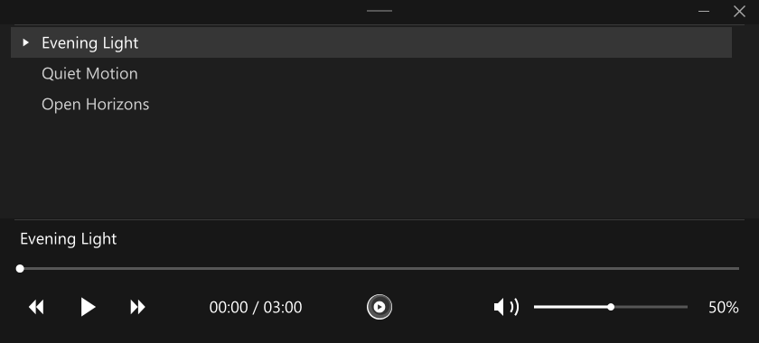

# MPV Audio Panel

**A dark, minimalist, monochrome audio interface for mpv on Windows.**

This package targets **Windows** and is tested on **Windows 11**. Its installers, native window controls and Snap integration are designed for Windows.



**[Install](#installation) · [Controls](#controls) · [Optional video profiles](#optional-video-profiles) · [Restore](#restore-or-uninstall) · [Contributing](CONTRIBUTING.md)**

The audio interface is the focus of this project. It adds a compact, carefully aligned playlist and playback controls using mpv's built-in Lua and drawing modules. **Audio is the recommended default installation.**

Video profiles are a separate, optional extra. Install them only when the system can decode and render the intended content comfortably, especially high-resolution HDR material. They are not required for the audio interface.

## Choose an installation

| Mode | Option in `Install.cmd` | Contents | Recommended for |
| --- | --- | --- | --- |
| **Audio** | `1 - Audio` | Audio UI and audio playback policy | Most installations, including modest hardware |
| **Video** | `2 - Video` | Capability-aware video profiles and video safety script | Systems suited to the intended video formats |
| **Both** | `3 - Both` | Both independent components | Audio UI plus optional video configuration |

`Install.cmd` is the single entry point: choose Audio, Video, Both, restore the latest backup, or exit without changes. Direct `Install.ps1` calls still default to **Audio** and support explicit `-Mode` for unattended use. Audio mode installs no video profiles or video safety script, changes no video rendering settings, and adds no HDR processing. The interface itself has a small drawing cost; it does not make mpv's resource usage literally zero or identical to an unmodified build.

## Audio features

- Dark, monochrome composition with a smooth, unnumbered playlist.
- Current song title above the progress bar.
- Carefully aligned playback timing, volume slider and percentage.
- Fixed vector speaker icons: sound waves when unmuted, a cross when muted.
- Subtle monochrome mpv logo between the controls.
- Native Windows resizing and Snap support with a custom header.
- Current media title in the window and taskbar during audio playback.
- Audio starts from the beginning, with file-local resume and save settings.
- Persistent audio mode between tracks, including audio with cover art.

No additional UI framework, font download or runtime service is needed. The approved interface composition is identical in Audio and Both modes.

## Requirements

- A recent [mpv](https://mpv.io/installation/) build. Tested on Windows 11 with **mpv 0.41.0-1205-g01e2533f3**.
- Windows PowerShell 5.1 or PowerShell 7 for the optional installer.
- A build supporting the relevant options, including `title-bar`, `auto-window-resize`, `autocreate-playlist` and `profile-restore=copy-equal`. Video mode additionally needs the included color-management options and properties. Check `mpv --list-options` when using an older build.

Other operating systems are not supported or tested by this package. Manual adaptation is possible, but font fallback, window decoration, dragging and HDR behavior depend on the platform, OS settings, renderer and build. The panel requests Segoe UI and uses normal mpv font fallback when unavailable.

## Installation

1. Install mpv separately and close its running windows.
2. Download this repository with **Code → Download ZIP** and extract it.
3. Double-click **`Install.cmd`** as your normal Windows user (administrator privileges are not required for the default per-user configuration) and choose **1** for Audio, **2** for Video or **3** for Both. Use **4** to restore the latest backup or **0** to exit without changes. For unattended use, open PowerShell in the extracted folder:

   ```powershell
   .\Install.ps1 -Mode Audio
   .\Install.ps1 -Mode Video
   .\Install.ps1 -Mode Both
   ```

   Run **one** command for the desired installation. Without `-Mode`, Audio is selected.

4. Restart mpv. Audio and Both show the panel automatically for audio files.

The default target is `%APPDATA%\mpv`. Normal per-user installation needs no administrator privileges. If Windows marks downloaded scripts as blocked, inspect them and use the file Properties **Unblock** option. If local policy prevents script execution, use manual installation.

### Existing configurations and switching modes

The installer backs up five managed paths: `mpv.conf`, both project scripts and both component configuration files. It preserves unrelated files and configuration text, adding one marked include block to `mpv.conf`. **Switching modes removes the unselected project components from those reserved paths**, after backing them up. Other controller scripts can still conflict and must be disabled separately.

The original, unmodified complete configuration from the first public package is migrated automatically. An edited legacy configuration containing the old project profiles requires a manual merge, so its customizations are not silently discarded. Installer backups remain available for exact restoration.

### Portable installation

When `portable_config` exists next to mpv, that directory takes precedence over the usual per-user location. Pass the active configuration directory explicitly:

```powershell
.\Install.ps1 -Mode Audio -ConfigDirectory 'D:\Apps\mpv\portable_config'
```

Replace the example path with the actual destination. Use the same directory for updates, mode changes and restoration.

### Manual installation

Back up the existing configuration first. Install only the selected component files, preserving their relative paths:

| Component | Files copied from `config/` |
| --- | --- |
| Audio | `scripts/audio-panel.lua`, `mpv-audio-panel/audio.conf` |
| Video | `scripts/video-safety.lua`, `mpv-audio-panel/video.conf` |

Add the matching include to `mpv.conf` under `[default]`:

```ini
[default]
include=~~/mpv-audio-panel/audio.conf
[default]
```

For Video, replace `audio.conf` with `video.conf`. For Both, include both files, placing `[default]` before and after each include. `config/mpv.conf` is a complete **Both** loader for reference; copying all of `config/` installs Both, not Audio alone.

Typical configuration locations are `%APPDATA%\mpv` on Windows and `~/.config/mpv` on Linux. See the [mpv manual](https://mpv.io/manual/master/#files) for other platforms. When switching a manual installation, remove the unselected component's include and script as well as its component configuration. Manual changes are outside installer backup management.

## Controls

| Area | Action |
| --- | --- |
| Playlist row | Play that entry |
| Playlist wheel / scrollbar | Scroll or drag through the list |
| Previous / play / next | Change track or pause/resume |
| Progress bar | Click or drag to seek |
| Speaker | Toggle mute |
| Volume bar | Click or drag to adjust volume |
| Header | Drag the native window |
| Header minimize / close | Minimize or quit mpv |

Normal mpv keyboard bindings remain available. The panel overrides mouse bindings only during audio mode. Double-clicking the panel does not toggle fullscreen. The starting size is 840 × 380; narrow windows may hide the logo or timing text to preserve usable controls.

## Audio customization

Create `script-opts/audio-panel.conf` in the active configuration directory:

```ini
scale=1.0
font_size=24
row_height=34
smoothness=18
```

`scale` adjusts overall size, with a minimum of 0.5. `font_size` changes text and numeric labels. Increase `row_height` with larger text. Higher `smoothness` values make scrolling settle faster. The default settings preserve the intended composition.

Audio preferences live in `mpv-audio-panel/audio.conf`. Keep the exact profile names `AUTO_MUSIC` and `AUDIO_PLAYBACK`: the panel manages their lifecycle and applies audio resume options per file. They do not set video rendering policy.

## Optional video profiles

**Video profiles are an extra, not a requirement for the audio UI.** Prefer Audio on hardware that struggles with the intended video, or when video configuration is already managed separately. Video settings cannot make an unsupported codec decodable or guarantee smooth playback of demanding content.

The optional component checks the decoded signal, active renderer and negotiated output. It separates confirmed HDR output from compatible tone mapping, validates HDR10+ scene metadata, and checks decoded Dolby Vision color representation rather than trusting a container label alone. It does not force a GPU vendor, hardware decoder, display mode, PQ output or fixed display brightness.

Peak computation stays automatic so mpv can check shader support. After a startup/seek grace period, sustained frame drops reduce optional processing for the rest of the track. A single dropped frame does not trigger degradation. This can reduce rendering work, but cannot solve an overloaded decoder, insufficient bandwidth or hardware limits.

**HDR10+ and Dolby Vision metadata processing is not native HDR10+/Dolby Vision passthrough.** A compatible renderer can use metadata to convert to SDR or HDR10 without requiring those display certifications. mpv does not expose a complete certification of GPU, cable, OS, driver and monitor support; missing evidence keeps the configuration on its compatibility path. OS HDR remains under system control.

See [Playback profiles](docs/profiles.md) for exact gates, precedence, performance behavior and limits.

The launcher prints a startup message before PowerShell starts, keeps errors visible until a key is pressed, and sets the execution policy only for its child PowerShell process. It does not change the machine or user execution policy.

## Restore or uninstall

Open **`Install.cmd`** and select **4** to restore the latest backup. The same menu is used for installation and updates; no separate launcher is required.

Close mpv and run:

```powershell
.\Restore.ps1
```

Pass the same `-ConfigDirectory` for portable installations. The latest backup is selected by default. Choose a specific backup using the folder name printed during installation:

```powershell
.\Restore.ps1 -ConfigDirectory 'D:\Apps\mpv\portable_config' -BackupName '<backup-folder-name>'
```

Backups remain in `mpv-audio-panel-backups/` inside the target directory. Restore checks their hashes first, restores original files byte for byte and removes managed files that were previously absent. **Later edits to managed files are replaced by restoration.** Version 1 backups remain supported for the two paths they originally covered; use the new installation's backup to roll back all component changes.

For manual rollback, restore each original file from the backup; when the manifest marks a file as originally absent, remove only that installed file. A manual installation can be undone by restoring the separately saved `mpv.conf` and removing the added component files.

## Troubleshooting

| Symptom | Check |
| --- | --- |
| Panel missing | Confirm Audio/Both mode, active config directory and both audio files |
| Unknown option | Update mpv or adapt the unsupported option for that build |
| Two controllers | Disable other controller/OSC scripts; only the built-in OSC is managed automatically |
| Video changes in Audio mode | Check pre-existing settings and other scripts; Audio installs no video profiles |
| HDR profile stays inactive | Inspect renderer/context and negotiated output; an HDR file tag alone is insufficient |
| Incorrect HDR colors | Confirm OS HDR, active display, renderer and calibration; no automatic chain certification is available |
| Demanding video stutters | Prefer Audio-only configuration or lower-demand media; optional processing fallback cannot fix decoding limits |
| Text clips | Restore default scale/window size or adjust text size and row height together |

For diagnostics, use `mpv --log-file=mpv.log <media-file>` and inspect errors. Do not publish logs without removing private paths and media information.

## Development and license

[CONTRIBUTING.md](CONTRIBUTING.md) documents lint and regression commands. CI checks Lua, PowerShell, package integrity and all three installation modes. The optional real-mpv suite checks 24 transitions across Audio, Video and Both when FFmpeg is available, plus synthetic capability and performance decisions. It does not certify physical HDR output, hardware formats or display behavior.

[GPL-2.0-or-later](LICENSE). Upstream artwork attribution is in [NOTICE](NOTICE). mpv is distributed separately. This is an independent package, not an official mpv release.
